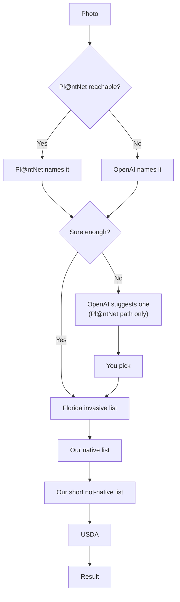

# EcoLoco-FL Architecture

## Part 1: How EcoLoco works (no coding needed)

You take or upload up to 5 photos of one plant and enter your school's Florida ZIP code. Pl@ntNet, a plant identification AI, guesses which plant it is. If Pl@ntNet's top matches are close, OpenAI looks at the photos and suggests one, and you still pick. If Pl@ntNet can't be reached, OpenAI names the plant instead. If that answer isn't sure either, you pick from OpenAI's list. If no match is strong enough, the app says it couldn't identify the plant. Then the app checks the plant against a few lists, in order, and stops at the first list that knows it. You see whether the plant is native, non-native or invasive, and which list the answer came from. If no list knows the plant, the app says so instead of guessing.

### Where each answer comes from

| Question | Where the answer comes from |
|---|---|
| What plant is this? | Pl@ntNet. If Pl@ntNet can't be reached, OpenAI looks at the photos instead. |
| Is it invasive? | Florida Invasive Species Council (FISC) 2026 list, 179 plants |
| Is it native? | Our list of 21 South Florida natives, then the USDA PLANTS database |
| Is it non-native but not invasive? | USF Atlas of Florida Plants (one plant so far: tropical sage), then USDA |
| What should our school plant? | Our list of 30 native plants, each checked by our team. Only shown for Palm Beach County ZIP codes. |
| Which plants feed the most caterpillars? | National Wildlife Federation keystone plant list for South Florida |
| What grows near our school? | iNaturalist, within about 5 km |
| Where is our school? | OpenStreetMap, plus a ZIP-to-county table from the 2020 Census |

### What the AI does and doesn't do

- Pl@ntNet names the plant from your photos. If Pl@ntNet can't be reached, OpenAI names it instead, and that answer goes through the same picker and list checks.
- When Pl@ntNet's top matches are close, OpenAI looks at the photos and suggests one. You still pick.
- OpenAI rewords the first paragraph of the letter to your principal. If the new wording adds a plant or changes a number, the app throws it out and keeps the original.
- The AI never decides if a plant is native or invasive, and never picks which plants to recommend. Those answers come only from the lists above.

### How we know it works

- 1124 automated tests check the backend, the data files and the app's wording. They all pass.
- **Coontie bug:** the same coontie photo got four different answers. Pl@ntNet split its score between two names for the same plant, so a Mexican plant won. Now the app merges names for the same plant before ranking, and shows "Which one is it?" when it isn't sure.
- **Asparagus fern bug:** asparagus fern showed as "Non-native" even though it is on Florida's invasive list. Pl@ntNet calls it *Asparagus densiflorus*, and our list only had *Asparagus aethiopicus*. We added the other names Pl@ntNet, USDA and POWO use for each invasive plant.

## Part 2: Technical details

The app is an Expo (SDK 57) React Native app that also runs on the web. It talks to a Python Flask backend. The frontend reads the backend address from `EXPO_PUBLIC_API_URL` (`frontend/services/geminiService.js`). API keys stay in the backend's `.env`.

### Folder structure

| Path | What's there |
|---|---|
| `App.js`, `index.js`, `app.json` | App start, safe-area setup, and Expo settings |
| `frontend/screens/` | One file per screen: `HomeScreen.js`, `IdentificationScreen.js`, `AuditScreen.js` (EcoScan), `AuditResultsScreen.js`, `RecommendationScreen.js` |
| `frontend/navigation/AppNavigator.js` | The four bottom tabs, plus the results screen |
| `frontend/components/` | Pieces shared between screens (match picker, plan cards, leaf ring, location picker, photo strip and more) |
| `frontend/services/geminiService.js` | Sends every request to the backend. The name is left over from an early Gemini version. |
| `frontend/theme.js`, `frontend/motion.js` | Colors, fonts, text sizes, and animation timing (turned off when reduce motion is on) |
| `frontend/photoFiles.js`, `frontend/photoFiles.web.js` | Photo picking. The web version also turns iPhone HEIC photos into JPEGs. |
| `frontend/cameraAccess.js`, `frontend/lastPlace.js` | Camera permission, and the last location set (kept in memory only) |
| `backend/app.py` | The Flask server and all API routes |
| `backend/services/` | The backend logic (see below) |
| `backend/data/` | Data files that ship with the backend (see below) |
| `backend/scripts/` | Scripts that rebuild data files from their official sources |
| `backend/tests/` | The pytest tests |
| `docs/architecture.html` | Interactive code map. Its `graph-data` JSON is the source for the generated sections at the end of this file. |
| `render.yaml` | Render hosting config for the backend |

### Main backend files

| File | What it does |
|---|---|
| `backend/app.py` | Defines the routes. Checks input: Florida ZIP codes only (32004 to 34997), 1 to 5 photos, JPEG or PNG, at most 10 MB each. |
| `backend/services/identification_service.py` | Sends photos to Pl@ntNet, merges names for the same plant, and decides between "identified", "confirm" (Which one is it?) and "unidentified". Calls OpenAI for close calls, or for everything if Pl@ntNet fails. |
| `backend/services/ai_service.py` | Builds what Identify shows, handles "choose by name", and builds the letter. The letter is made from the plan, and OpenAI may only reword its opening. |
| `backend/services/fl_plants_service.py` | `get_status()` checks a plant in order: FISC, our natives, our Atlas non-natives, then USDA. |
| `backend/services/species_service.py` | `resolve()` turns any name (scientific name, synonym or common name) into one scientific name. |
| `backend/services/usda_service.py` | Asks the USDA PLANTS database if a plant is native to Florida. |
| `backend/services/plan_service.py` | Builds the plan: a Remove card for each invasive found, and Add cards from our 30 checked plants. |
| `backend/services/summary_service.py` | Counts plants by status and works out percent native, now and with the plan. |
| `backend/services/location_service.py` | Address and ZIP lookup (OpenStreetMap Nominatim), the Palm Beach County check, and "Seen near you" (iNaturalist). |
| `backend/services/name_search.py` | Search for "Choose by name" over 5322 plant names recorded in Florida. |
| `backend/services/name_guard.py` | Checks that the AI's letter wording adds no new plant or animal names. |
| `backend/services/photo_service.py` | Finds the stored photo and photo credit for a plant. |
| `backend/services/openai_client.py` | The one place that calls OpenAI (model `gpt-4o-mini`, temperature 0). |

Identification thresholds, from `identification_service.py`:
- Top Pl@ntNet score under 0.20: "Couldn't identify this".
- Matches under 0.05 are dropped.
- Top score under 0.80, or within 0.15 of the runner-up: "Which one is it?".

### API endpoints

All routes are `POST` and live in `backend/app.py`.

| Route | Takes | Gives back |
|---|---|---|
| `/identify` | `images` (1 to 5 photos), `location` (ZIP) | Ranked matches, each with Florida status and source |
| `/names` | `query` (up to 80 characters) | Up to 20 matching Florida plant names |
| `/choose` | `scientific_name`, `location` | The same result shape as `/identify`, for a plant picked by name |
| `/recommend` | `location`, optional `site` (light, moisture, space, care) | Native plants to add, and whether this ZIP is checked for planting advice |
| `/plan` | `plants`, `location`, optional `skip`, `site`, `show_all`, `letter_extras` | Remove cards, Add cards, and the percent native summary |
| `/locate` | `query` (address or ZIP), or `lat` and `lon` | Rounded coordinates and a Florida ZIP |
| `/nearby` | `lat`, `lon` | The 5 plants seen most within about 5 km, from iNaturalist |
| `/letter` | `plan`, `zip_code` | The letter text, and whether the AI was available |

### Data files

All are in `backend/data/` and ship with the backend.

| File | What's in it |
|---|---|
| `fisc_list.json` | The FISC 2026 invasive list: 179 plants (85 Category I, 94 Category II), with other names for each. Built by `backend/scripts/build_fisc_list.py`. |
| `fl_natives.json` | 21 South Florida native plants |
| `fl_non_natives.json` | Plants the USF Atlas lists as not native (1 so far: tropical sage) |
| `fl_recommendations.json` | 30 native plants we recommend, each marked verified, with sources |
| `fl_plant_names.json` | 5322 plant names from the USDA Florida checklist, for "Choose by name" |
| `fl_zip_counties.json` | 1013 Florida ZIP codes and their county, from the 2020 Census |
| `nwf_keystone_fl.json` | NWF Ecoregion 15 caterpillar counts by plant group |
| `plant_photos.json` | 198 openly licensed iNaturalist photos with credits |
| `why_this_matters.json` | The sourced facts in "Why this matters" on the results screen |
| `nature_terms.json` | Plant and animal words the letter check watches for |

### Outside services

| Service | Used for | Called from |
|---|---|---|
| Pl@ntNet | Naming the plant from photos | `backend/services/identification_service.py` |
| OpenAI (`gpt-4o-mini`) | Breaking close calls, naming the plant if Pl@ntNet is down, rewording the letter opening | `backend/services/openai_client.py` |
| USDA PLANTS | Native or introduced, for plants not on our lists | `backend/services/usda_service.py` |
| OpenStreetMap Nominatim | Turning an address or GPS point into a ZIP code | `backend/services/location_service.py` |
| iNaturalist | "Seen near you" | `backend/services/location_service.py` |

## Full code map

The interactive version is at https://aydinheugh.github.io/EcoLoco-FL/, or open [`docs/architecture.html`](docs/architecture.html) locally. It needs internet to load its layout library. Click any box to see what that file or function does, what it calls, and what calls it.

### Keeping this in sync

The `graph-data` JSON block in `docs/architecture.html` is the single source of truth. Everything between the `GENERATED` markers below is produced from it. After a significant change:

1. Edit the nodes and edges in `docs/architecture.html` (each node has a file, symbol, what, how, and an optional goal).
2. Run `node docs/sync-architecture.mjs`. It fails if a node points at code that no longer exists, or if a screen, API client function, route or service function has no node. It warns when a PLANNED node's code now exists. Then it rewrites the sections below.
3. `node docs/sync-architecture.mjs --check` only checks, without rewriting.

### Layers in the diagram

| Layer | What it means | Where |
|---|---|---|
| **Screen / UI** | What the user sees and taps | `frontend/screens/`, `frontend/components/`, `frontend/navigation/AppNavigator.js` |
| **Device** | Phone features the app uses: camera, photo library, clipboard | `expo-image-picker`, `expo-clipboard` |
| **API client** | Frontend functions that send requests to our backend | `frontend/services/geminiService.js` |
| **Flask route** | A backend URL that receives those requests | `backend/app.py` |
| **Service** | Backend functions that do the work | `backend/services/*.py` |
| **Bundled data** | Data files that ship with the backend | `backend/data/*.json` |
| **External API** | Outside services the backend calls | Pl@ntNet, OpenAI, USDA, Nominatim, iNaturalist |

| Marker | What it means |
|---|---|
| **Planned** | Doesn't exist yet but is decided. Drawn dashed, with its goal. |
| **Change planned** | Exists today, but a planned change will modify it. |
| **Dead code** | Exists but does nothing useful. Drawn dotted grey. |

### Planned and pending changes

<!-- GENERATED:planned -->
| Item | Status | Goal |
|---|---|---|
| `identifyPlant()` (frontend/services/geminiService.js) | change planned | File becomes apiClient.js, since it calls our Flask API, not Gemini. |
| `getPlantRecommendations()` (frontend/services/geminiService.js) | change planned | File becomes apiClient.js, since it calls our Flask API, not Gemini. |
| `generateLetter()` (frontend/services/geminiService.js) | change planned | File becomes apiClient.js, since it calls our Flask API, not Gemini. |
| `getLocalPlants()` (frontend/services/plantService.js) | DEAD | Delete plantService.js: the backend route it called has been removed. |
| `Flask app (app.py)` (backend/app.py) | change planned | Deploy to a public host before the demo (today: localhost with debug=True). |
| `get_status()` (backend/services/fl_plants_service.py) | change planned | Add ZIP-specific regional lists behind the same get_status(). |
| `fisc_list.json` (backend/data/fisc_list.json) | change planned | Verify the 22 curated "why" lines against FISC / UF-IFAS before the demo. |
| `fl_natives.json` (backend/data/fl_natives.json) | change planned | Verify every entry against UF/IFAS and the Atlas of Florida Plants before the demo. |
| `getPlan()` (frontend/services/geminiService.js) | change planned | File becomes apiClient.js, since it calls our Flask API, not Gemini. |
| `locate()` (frontend/services/geminiService.js) | change planned | File becomes apiClient.js, since it calls our Flask API, not Gemini. |
| `getNearby()` (frontend/services/geminiService.js) | change planned | File becomes apiClient.js, since it calls our Flask API, not Gemini. |
<!-- /GENERATED:planned -->

### Diagram

```mermaid
flowchart LR
  subgraph L_ui["Screens & UI"]
    direction TB
    app["AppNavigator"]
    home["HomeScreen"]
    ident["IdentificationScreen"]
    rec["RecommendationScreen"]
    audit["AuditScreen (EcoScan)"]
    results["AuditResultsScreen"]
    ui_why["Sourced facts on Identify"]
    ui_receipt["SourceLine"]
    letter["LetterGenerator"]
    ui_multiphoto["Multi-photo upload + progress text"]
    ui_ai_unknown["OfflineNotice"]
    ui_picker["CandidatePicker + StatusBadge"]
    ui_ring["PercentRing"]
    ui_plancard["PlanCard + SourceLine"]
    ui_location["LocationPicker"]
    ui_charts["StatusBars + CaterpillarBars"]
    ui_atlas["AtlasButton"]
    ui_namepicker["NamePicker"]
    ui_sitefilters["SiteFilters"]
    ui_photodrop["usePhotoDrop()"]
    ui_photofiles["pickPhotos()"]
    ui_photostrip["PhotoStrip"]
    ui_letterdemo["LetterDemo"]
    ui_identifydemo["IdentifyDemo"]
    ui_theme["theme.js"]
    ui_motion["motion.js"]
    ui_photos["photos.js"]
    ui_photoslot["PhotoSlot"]
    ui_header["ScreenHeader"]
    ui_leaf["ScanningLeaf"]
    ui_reveal["Reveal"]
    ui_countup["CountUp"]
    ui_lastplace["lastPlace.js"]
    ui_camera["askForCamera()"]
    ui_photo["PlantPhoto"]
    ui_press["PressScale"]
    ui_tabicon["TabIcon"]
    ui_rotating["RotatingLine"]
  end
  subgraph L_device["Device"]
    direction TB
    picker["expo-image-picker"]
    clipboard["expo-clipboard"]
  end
  subgraph L_client["API client"]
    direction TB
    c_identify["identifyPlant()"]
    c_rec["getPlantRecommendations()"]
    c_letter["generateLetter()"]
    c_local["getLocalPlants()<br/>DEAD: Delete plantService.js: the backend route it called has been removed."]
    c_plan["getPlan()"]
    c_user_message["userMessage()"]
    c_locate["locate()"]
    c_nearby["getNearby()"]
    c_names["searchNames()"]
    c_choose["choosePlant()"]
  end
  subgraph L_route["Flask routes"]
    direction TB
    flask["Flask app (app.py)"]
    r_identify["POST /identify"]
    r_recommend["POST /recommend"]
    r_letter["POST /letter"]
    r_plan["POST /plan"]
    r_locate["POST /locate"]
    r_nearby["POST /nearby"]
    r_names["POST /names"]
    r_choose["POST /choose"]
  end
  subgraph L_svc["Services"]
    direction TB
    s_identify["identify_plant()"]
    s_letter["generate_letter()"]
    s_fl["get_status()"]
    s_species["identify_species()"]
    s_plantnet["identify_with_plantnet()"]
    s_usda["florida_status()"]
    s_resolve["resolve()"]
    s_option["plant_option()"]
    s_common_name["common_name()"]
    s_summary["summarize()"]
    s_plan["build_plan()"]
    s_guard["mentions_new_names()"]
    s_letter_facts["letter_facts()"]
    s_round["round_coords()"]
    s_geocode["geocode()"]
    s_reverse["reverse_zip()"]
    s_seen["seen_near()"]
    s_with_plan["with_plan()"]
    s_zip_center["zip_center()"]
    s_region["plantings_checked()"]
    s_county["county()"]
    s_choose["choose_plant()"]
    s_namesearch["search()"]
    s_isknown["is_known()"]
    s_commonfor["common_name_for()"]
    s_fits["fits_site()"]
    s_cleansite["clean_site()"]
    s_lightof["light_of()"]
    s_spaceof["space_of()"]
    s_checked["checked_value()"]
    s_photo["photo_for()"]
  end
  subgraph L_data["Bundled data"]
    direction TB
    d_fisc["fisc_list.json"]
    d_natives["fl_natives.json"]
    fisc_builder["build_fisc_list.py"]
    d_recs["fl_recommendations.json"]
    d_nwf["nwf_keystone_fl.json"]
    d_terms["nature_terms.json"]
    d_why["why_this_matters.json"]
    d_zip_counties["fl_zip_counties.json"]
    zip_builder["build_zip_counties.py"]
    d_non_natives["fl_non_natives.json"]
    d_plantnames["fl_plant_names.json"]
    names_builder["build_fl_plant_names.py"]
    d_photos["plant_photos.json"]
  end
  subgraph L_ext["External APIs"]
    direction TB
    openai["OpenAI (gpt-4o-mini)"]
    usda["USDA PLANTS"]
    plantnet["PlantNet API"]
    nominatim["Nominatim (OpenStreetMap)"]
    inaturalist["iNaturalist API"]
    usf_atlas["USF Atlas of Florida Plants"]
  end
  app -->|"tab: Home"| home
  app -->|"tab: Identify"| ident
  app -->|"tab: Recommend"| rec
  app -->|"tab: EcoScan"| audit
  app -->|"stack screen: AuditResults"| results
  home -->|"navigate('Camera')"| ident
  home -->|"navigate('Recommend')"| rec
  ident -->|"navigate('Recommend', {prefillZip})"| rec
  audit -->|"navigate('AuditResults', {plants[], zipCode})"| results
  results -->|"navigate(Main → Recommend, {prefillZip})"| rec
  results -->|"renders LetterGenerator {plan, zipCode}"| letter
  ident -->|"launchCamera / launchImageLibrary → {uri, base64}"| picker
  audit -->|"launchCamera / launchImageLibrary → {uri, base64}"| picker
  letter -->|"setStringAsync(editedLetter)"| clipboard
  ident -->|"renders why, helps, watch_out, removal_safety"| ui_why
  ident -->|"Source: … under each fact"| ui_receipt
  ident -->|"identifyPlant(photo.base64, zipCode)"| c_identify
  audit -->|"identifyPlant(photo.base64, zipCode) per scan"| c_identify
  rec -->|"getPlantRecommendations(zip)"| c_rec
  letter -->|"generateLetter(plan, zipCode)"| c_letter
  c_identify -->|"POST /identify {image, location}"| r_identify
  c_rec -->|"POST /recommend {location}"| r_recommend
  c_letter -->|"POST /letter {plan, zip_code}"| r_letter
  flask -->|"registers"| r_identify
  flask -->|"registers"| r_recommend
  flask -->|"registers"| r_letter
  r_identify -->|"identify_plant(image, location)"| s_identify
  r_letter -->|"generate_letter(plan, zip_code)"| s_letter
  s_letter -->|"opening paragraph + plain-language system prompt → reworded paragraph"| openai
  s_fl -->|"match scientific_name"| d_fisc
  s_fl -->|"match scientific_name"| d_natives
  s_identify -->|"identify_species(images, location) → state, ranked options, suggested"| s_species
  s_species -->|"unsure: suggest one of PlantNet's options · PlantNet failed: identify from photos"| openai
  ident -->|"1–5 photos, progress text"| ui_multiphoto
  audit -->|"1–5 photos, progress text"| ui_multiphoto
  s_species -->|"identify_with_plantnet(images) → ranked species + scores"| s_plantnet
  s_plantnet -->|"POST /v2/identify/all (1–5 photos) → results[]"| plantnet
  ident -->|"reportAi(result.ai_unavailable)"| ui_ai_unknown
  audit -->|"reportAi(result.ai_unavailable)"| ui_ai_unknown
  s_fl -->|"florida_status(name) → native / introduced / None"| s_usda
  s_usda -->|"search → profile → FL distribution"| usda
  fisc_builder -->|"writes 179 species from the official PDF"| d_fisc
  s_identify -->|"plant_option(name, common_name, confidence, zip) per option → status, labels, why"| s_option
  s_option -->|"get_status(name, zip) → native, invasive, source, why"| s_fl
  s_option -->|"resolve(name) → one scientific name"| s_resolve
  s_fl -->|"resolve(name) before any list lookup"| s_resolve
  s_species -->|"resolve(name) to merge names of the same species"| s_resolve
  s_resolve -->|"names, synonyms, common names"| d_fisc
  s_resolve -->|"names, synonyms, common names"| d_natives
  ident -->|"unsure match → pick one or #quot;None of these#quot;"| ui_picker
  audit -->|"unsure card → pick one or #quot;None of these#quot;"| ui_picker
  s_option -->|"common_name(scientific_name) → our name for it"| s_common_name
  s_common_name -->|"resolve(name)"| s_resolve
  s_summary -->|"plant_option(name) per plant → status"| s_option
  results -->|"percent_native, percent_native_with_plan"| ui_ring
  results -->|"getPlan(plants, zipCode, skip, site, showAll, extras)"| c_plan
  c_plan -->|"POST /plan {plants, location, skip, site, show_all, letter_extras}"| r_plan
  flask -->|"registers"| r_plan
  r_plan -->|"build_plan(plants, plantings_checked)"| s_plan
  r_recommend -->|"build_plan([], checked) → add cards"| s_plan
  s_plan -->|"summarize(plants, added_natives)"| s_summary
  s_plan -->|"verified plants, facts, replaces"| d_recs
  s_plan -->|"genus → caterpillar count for the group"| d_nwf
  s_option -->|"helps, watch_out, atlas_url for known plants"| d_recs
  s_resolve -->|"names, common names"| d_recs
  s_letter -->|"letter_facts(plan, zip) → template text"| s_letter_facts
  s_letter -->|"mentions_new_names(reply, opening)"| s_guard
  s_guard -->|"animal and plant words"| d_terms
  results -->|"Remove and Add cards"| ui_plancard
  rec -->|"Add cards"| ui_plancard
  results -->|"error text"| c_user_message
  results -->|"Source: … under each fact"| ui_receipt
  ui_plancard -->|"Source: … under each row"| ui_receipt
  s_plan -->|"why_this_matters lines"| d_why
  letter -->|"reportAi(ai_unavailable)"| ui_ai_unknown
  home -->|"navigate('EcoScan')"| audit
  ident -->|"school location → ZIP"| ui_location
  audit -->|"school location → ZIP"| ui_location
  rec -->|"school location → ZIP"| ui_location
  ui_location -->|"locate({lat, lon} or {query})"| c_locate
  c_locate -->|"POST /locate"| r_locate
  results -->|"getNearby(lat, lon)"| c_nearby
  c_nearby -->|"POST /nearby {lat, lon}"| r_nearby
  flask -->|"registers"| r_locate
  flask -->|"registers"| r_nearby
  r_locate -->|"round_coords(lat, lon)"| s_round
  r_locate -->|"geocode(query)"| s_geocode
  r_locate -->|"reverse_zip(lat, lon)"| s_reverse
  r_nearby -->|"seen_near(lat, lon)"| s_seen
  s_geocode -->|"search, 1 request per second"| nominatim
  s_geocode -->|"no postcode → ZIP at the center"| s_reverse
  s_reverse -->|"reverse, 1 request per second"| nominatim
  s_seen -->|"research-grade plants within 5 km"| inaturalist
  s_seen -->|"plant_option() → Florida status"| s_option
  results -->|"counts, counts_with_plan, nwf per card"| ui_charts
  s_plan -->|"with_plan(base, added natives, invasives replaced)"| s_with_plan
  s_summary -->|"with_plan(summary)"| s_with_plan
  r_locate -->|"typed 5-digit ZIP → zip_center(zip)"| s_zip_center
  s_zip_center -->|"postal code search"| nominatim
  ui_plancard -->|"Add card's atlas_url"| ui_atlas
  ident -->|"verified plant's atlas_url"| ui_atlas
  ui_atlas -->|"openBrowserAsync(url)"| usf_atlas
  r_plan -->|"plantings_checked(location)"| s_region
  r_recommend -->|"plantings_checked(location)"| s_region
  s_region -->|"county(zip)"| s_county
  zip_builder -->|"writes 1,013 Florida ZIPs"| d_zip_counties
  results -->|"forgetScannedPlant(id) on Remove"| audit
  s_county -->|"ZIP → county"| d_zip_counties
  s_fl -->|"not native per the Atlas"| d_non_natives
  audit -->|"Choose by name on a plant card"| ui_namepicker
  ident -->|"Choose by name"| ui_namepicker
  ui_namepicker -->|"searchNames(text)"| c_names
  audit -->|"choosePlant(name, zip)"| c_choose
  ident -->|"choosePlant(name, zip)"| c_choose
  c_names -->|"POST /names {query}"| r_names
  c_choose -->|"POST /choose {scientific_name, location}"| r_choose
  r_names -->|"search(query)"| s_namesearch
  r_choose -->|"is_known(name)"| s_isknown
  r_choose -->|"common_name_for(name)"| s_commonfor
  r_choose -->|"choose_plant(name, common, zip)"| s_choose
  s_choose -->|"same status check as a scan"| s_option
  s_namesearch -->|"USDA Florida names"| d_plantnames
  names_builder -->|"writes 5,322 Florida plants"| d_plantnames
  rec -->|"site choices"| ui_sitefilters
  results -->|"site choices"| ui_sitefilters
  s_plan -->|"clean_site(site)"| s_cleansite
  s_plan -->|"fits_site(rec, site)"| s_fits
  s_fits -->|"light from sun text"| s_lightof
  s_fits -->|"room from type and size"| s_spaceof
  s_fits -->|"moisture and care, only if checked"| s_checked
  audit -->|"photos on a plant card"| ui_photostrip
  ident -->|"photos added"| ui_photostrip
  home -->|"Write to Your Principal"| ui_letterdemo
  home -->|"Identify a Plant"| ui_identifydemo
  home -->|"PHOTOS.home"| ui_photos
  ident -->|"title, subtitle, photo"| ui_header
  audit -->|"title, photo, New Scan"| ui_header
  rec -->|"title, photo"| ui_header
  results -->|"Your plan, photo"| ui_header
  ui_header -->|"photo"| ui_photoslot
  ident -->|"while identifying"| ui_leaf
  audit -->|"while scanning"| ui_leaf
  rec -->|"PlanCards"| ui_reveal
  results -->|"PlanCards"| ui_reveal
  ui_ring -->|"useReduceMotion"| ui_motion
  ui_reveal -->|"DURATION, useReduceMotion"| ui_motion
  ui_picker -->|"feelResult(status)"| ui_motion
  results -->|"group counts"| ui_countup
  home -->|"How We Know numbers"| ui_countup
  ui_charts -->|"useCountUp"| ui_countup
  ui_countup -->|"useInView"| ui_reveal
  ident -->|"rememberPlace(place)"| ui_lastplace
  audit -->|"rememberPlace(place)"| ui_lastplace
  rec -->|"lastPlace()"| ui_lastplace
  ident -->|"askForCamera()"| ui_camera
  ident -->|"usePhotoDrop(id) → photos [{uri, base64}]"| ui_photodrop
  audit -->|"usePhotoDrop(id) → photos [{uri, base64}]"| ui_photodrop
  ident -->|"pickPhotos(room) → {photos, extra}"| ui_photofiles
  audit -->|"pickPhotos(room) → {photos, extra}"| ui_photofiles
  ui_photodrop -->|"photoFromFile(file)"| ui_photofiles
  ui_photofiles -->|"launchImageLibraryAsync() (phone only)"| picker
  audit -->|"askForCamera()"| ui_camera
  ui_camera -->|"requestCameraPermissionsAsync()"| picker
  s_plan -->|"photo_for(name)"| s_photo
  s_photo -->|"reads"| d_photos
  ui_plancard -->|"card.photo"| ui_photo
  results -->|"plant photos"| ui_photo
  app -->|"tab icons"| ui_tabicon
  ident -->|"Identify Plant"| ui_press
  audit -->|"Scan all, See my results"| ui_press
  s_option -->|"photo_for(name)"| s_photo
  home -->|"six catchphrases"| ui_rotating
  classDef ui fill:#e3f2e1,stroke:#2e7d32,color:#12301a
  classDef device fill:#eceff1,stroke:#607d8b,color:#263238
  classDef client fill:#e1effa,stroke:#1e6fb8,color:#0d2d4d
  classDef route fill:#fff1d6,stroke:#c77800,color:#4a2c00
  classDef svc fill:#f1e4f7,stroke:#7b3fa0,color:#2e0f40
  classDef data fill:#e0f4f1,stroke:#00897b,color:#00332d
  classDef ext fill:#fde4e1,stroke:#c0392b,color:#4a0f08
  classDef planned stroke-dasharray:6 4,stroke-width:2px
  classDef dead fill:#f3f3f3,stroke:#9e9e9e,color:#616161,stroke-dasharray:3 3
  class app,home,ident,rec,audit,results,ui_why,ui_receipt,letter,ui_multiphoto,ui_ai_unknown,ui_picker,ui_ring,ui_plancard,ui_location,ui_charts,ui_atlas,ui_namepicker,ui_sitefilters,ui_photodrop,ui_photofiles,ui_photostrip,ui_letterdemo,ui_identifydemo,ui_theme,ui_motion,ui_photos,ui_photoslot,ui_header,ui_leaf,ui_reveal,ui_countup,ui_lastplace,ui_camera,ui_photo,ui_press,ui_tabicon,ui_rotating ui
  class picker,clipboard device
  class c_identify,c_rec,c_letter,c_local,c_plan,c_user_message,c_locate,c_nearby,c_names,c_choose client
  class flask,r_identify,r_recommend,r_letter,r_plan,r_locate,r_nearby,r_names,r_choose route
  class s_identify,s_letter,s_fl,s_species,s_plantnet,s_usda,s_resolve,s_option,s_common_name,s_summary,s_plan,s_guard,s_letter_facts,s_round,s_geocode,s_reverse,s_seen,s_with_plan,s_zip_center,s_region,s_county,s_choose,s_namesearch,s_isknown,s_commonfor,s_fits,s_cleansite,s_lightof,s_spaceof,s_checked,s_photo svc
  class d_fisc,d_natives,fisc_builder,d_recs,d_nwf,d_terms,d_why,d_zip_counties,zip_builder,d_non_natives,d_plantnames,names_builder,d_photos data
  class openai,usda,plantnet,nominatim,inaturalist,usf_atlas ext
  class c_local dead
```

<!-- GENERATED:mermaid -->

<!-- /GENERATED:mermaid -->
