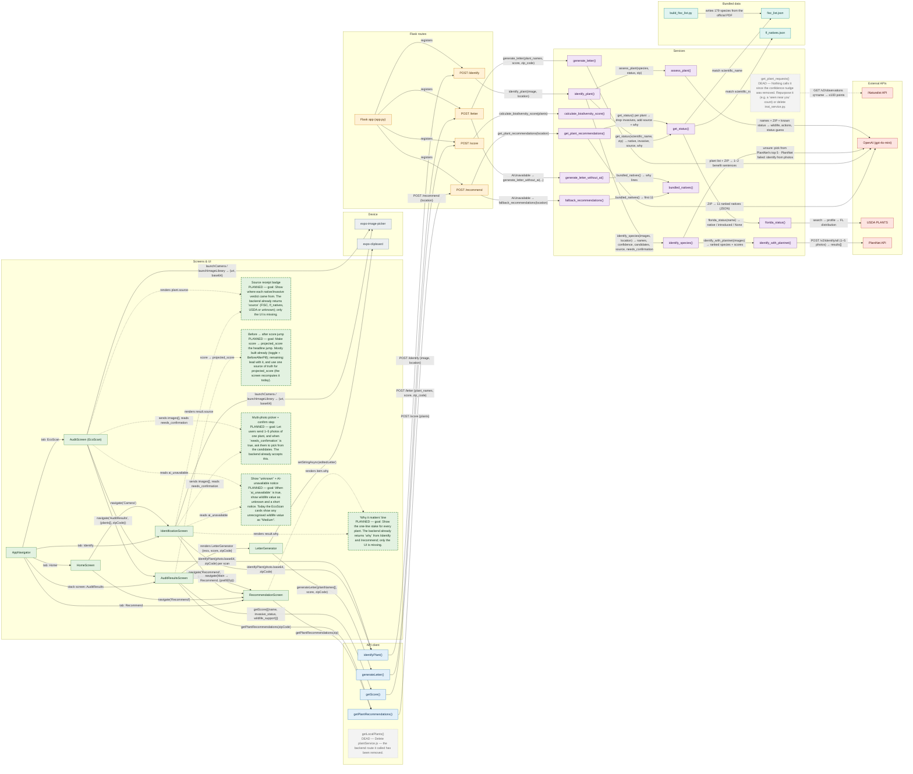

# EcoLoco-FL Architecture

Map of the whole app: Expo screens → API client → Flask routes → services → bundled data and external APIs.

**Interactive version:** https://aydinheugh.github.io/EcoLoco-FL/ (or open
[`docs/architecture.html`](docs/architecture.html) locally; it needs internet for the React Flow CDN). Drag nodes, pan and zoom, and click any node for a side panel
explaining what that file or function does, the steps it runs, what it calls, and what calls it.

## Keeping this in sync

The graph data lives in one place: the `graph-data` JSON block in `docs/architecture.html`.
Everything between the `GENERATED` markers below is produced from it. After a significant change:

1. Edit the nodes/edges in `docs/architecture.html` (each node: file, symbol, what, how, goal).
2. Run `node docs/sync-architecture.mjs`. It fails if a node points at code that no longer
   exists, or if a screen, API-client function, route or service function has no node. It warns
   when a PLANNED node's code now exists (so you can drop the tag). Then it rewrites the sections below.
3. `node docs/sync-architecture.mjs --check` only verifies, which makes it usable in CI.

## Glossary

A scan travels Screen → API client → Flask route → Service → External API / Bundled data,
and the answer comes back the same way.

### Layers

| Color | Term | What it means | Where |
|---|---|---|---|
| green | **Screen / UI** | What the user sees and taps in the Expo app. | `frontend/screens/`, `frontend/navigation/AppNavigator.js` |
| grey | **Device** | Phone features the app borrows: camera/photo library and clipboard. | `expo-image-picker`, `expo-clipboard` |
| blue | **API client** | Small frontend functions that send requests over the internet to our backend. | `frontend/services/geminiService.js`, `plantService.js` |
| orange | **Flask route** | A backend URL that receives those requests — the front door of the Python server. | `backend/app.py` |
| purple | **Service** | Backend functions that do the real work once a route gets a request. | `backend/services/*.py` |
| teal | **Bundled data** | Data files shipped with the backend instead of fetched online. | `backend/data/*.json` (planned) |
| red | **External API** | Outside services the backend calls: OpenAI, iNaturalist, OpenStreetMap Nominatim (ZIP → location), USDA later. | — |

### Markers

| Term | What it means |
|---|---|
| **Planned** | Doesn't exist yet but is decided. Drawn dashed, with its goal. |
| **Change planned** | Exists today, but a planned change will modify it (e.g. a rename). |
| **Dead code** | Exists but does nothing useful. Drawn dotted grey. |
| **Calls it** (orange) | In the interactive page, after clicking a node: the nodes that use it. |
| **It calls** (blue) | In the interactive page, after clicking a node: the nodes it uses. |

## Planned and pending changes

<!-- GENERATED:planned -->
| Item | Status | Goal |
|---|---|---|
| `'Why it matters' line` | PLANNED | Show the one-line stake for every plant. The backend already returns `why` from /identify and /recommend; only the UI is missing. |
| `Source receipt badge` | PLANNED | Show where each native/invasive verdict came from. The backend already returns `source` (FISC, fl_natives, USDA or unknown); only the UI is missing. |
| `Before → after score jump` | PLANNED | Make score → projected_score the headline jump. Mostly built already (toggle + BeforeAfterPill); remaining: lead with it, and use one source of truth for projected_score (the screen recomputes it today). |
| `identifyPlant()` (frontend/services/geminiService.js) | change planned | File becomes apiClient.js — it calls our Flask API, not Gemini. |
| `getPlantRecommendations()` (frontend/services/geminiService.js) | change planned | File becomes apiClient.js — it calls our Flask API, not Gemini. |
| `getScore()` (frontend/services/geminiService.js) | change planned | File becomes apiClient.js — it calls our Flask API, not Gemini. |
| `generateLetter()` (frontend/services/geminiService.js) | change planned | File becomes apiClient.js — it calls our Flask API, not Gemini. |
| `getLocalPlants()` (frontend/services/plantService.js) | DEAD | Delete plantService.js — the backend route it called has been removed. |
| `Flask app (app.py)` (backend/app.py) | change planned | Deploy to a public host before the demo (today: localhost with debug=True). |
| `get_plant_requests()` (backend/services/inat_service.py) | DEAD | Nothing calls it since the confidence nudge was removed. Repurpose it (e.g. a 'seen near you' count) or delete inat_service.py. |
| `get_plant_recommendations()` (backend/services/ai_service.py) | change planned | Pick the candidates from fl_natives.json instead of asking GPT for the list; GPT would then only write the wording. |
| `get_status()` (backend/services/fl_plants_service.py) | change planned | Add ZIP-specific regional lists behind the same get_status(). |
| `fisc_list.json` (backend/data/fisc_list.json) | change planned | Verify the 22 curated "why" lines against FISC / UF-IFAS before the demo. |
| `fl_natives.json` (backend/data/fl_natives.json) | change planned | Verify every entry against UF/IFAS and the Atlas of Florida Plants before the demo. |
| `Multi-photo picker + confirm step` | PLANNED | Let users send 1–5 photos of one plant, and when `needs_confirmation` is true, ask them to pick from the candidates. The backend already accepts this. |
| `Show "unknown" + AI-unavailable notice` | PLANNED | When `ai_unavailable` is true, show wildlife value as unknown and a short notice. Today the EcoScan cards show any unrecognised wildlife value as "Medium". |
<!-- /GENERATED:planned -->

## Diagram

<!-- GENERATED:mermaid -->

<!-- /GENERATED:mermaid -->
