# EcoLoco-FL Architecture

Map of the app: Expo screens → bounded API requests → validated Flask routes → sourced taxon evidence, survey calculations and proposals. Device storage preserves audit facts and draft edits; provider calls are limited to identification-related work.

**Interactive version:** https://aydinheugh.github.io/EcoLoco-FL/ (or open
[`docs/architecture.html`](docs/architecture.html) locally; it needs internet for the React Flow CDN). Drag nodes, pan and zoom, and click any node for a side panel
explaining what that file or function does, the steps it runs, what it calls, and what calls it.

## Keeping this in sync

The graph data lives in one place: the `graph-data` JSON block in `docs/architecture.html`.
Everything between the `GENERATED` markers below is produced from it. After a significant change:

1. Edit the nodes/edges in `docs/architecture.html` (each node: file, symbol, what, how, goal).
2. Run `node docs/sync-architecture.mjs`. It fails if a node points at code that no longer
   exists, or if a screen, API-client function, route or service function has no node. It warns
   when a PLANNED node's code now exists (so you can drop the tag). Then it rewrites the sections below.
3. `node docs/sync-architecture.mjs --check` only verifies, which makes it usable in CI.

## Glossary

A scan travels Screen → API client → Flask route → Service → External API / Bundled data,
and the answer comes back the same way.

### Layers

| Color | Term | What it means | Where |
|---|---|---|---|
| green | **Screen / UI** | What the user sees and taps in the Expo app. | `frontend/screens/`, `frontend/navigation/AppNavigator.js` |
| grey | **Device** | Device features for photos, local audit persistence and report sharing. | `expo-image-picker`, image preparation, AsyncStorage, clipboard/share |
| blue | **API client** | Frontend requests, audit storage and evidence/photo rules. | `frontend/services/`, `frontend/utils/` |
| orange | **Flask route** | A backend URL that receives those requests — the front door of the Python server. | `backend/app.py` |
| purple | **Service** | Backend functions that do the real work once a route gets a request. | `backend/services/*.py` |
| teal | **Bundled data** | Data files shipped with the backend instead of fetched online. | `backend/data/*.json` |
| red | **External API** | PlantNet and OpenAI for identification; USDA is optional distribution research and iNaturalist is unused legacy code. | — |

### Markers

| Term | What it means |
|---|---|
| **Planned** | Doesn't exist yet but is decided. Drawn dashed, with its goal. |
| **Change planned** | Exists today, but a planned change will modify it (e.g. a rename). |
| **Dead code** | Exists but does nothing useful. Drawn dotted grey. |
| **Calls it** (orange) | In the interactive page, after clicking a node: the nodes that use it. |
| **It calls** (blue) | In the interactive page, after clicking a node: the nodes it uses. |

## Planned and pending changes

<!-- GENERATED:planned -->
| Item | Status | Goal |
|---|---|---|
| `getLocalPlants()` (frontend/services/plantService.js) | DEAD | Remove this unused client when cleaning up legacy integrations. |
| `Flask app` (backend/app.py) | change planned | Choose a public HTTPS host and configure credentials, allowed origins, budgets and shared gateway limits before external demonstrations. |
| `get_plant_requests()` (backend/services/inat_service.py) | DEAD | Remove or separately redesign this legacy helper; do not use nearby sightings as identification confidence. |
| `iNaturalist API` (backend/services/inat_service.py) | DEAD | Retire with the unused helper or design a separately scoped observation feature. |
<!-- /GENERATED:planned -->

## Diagram

```mermaid
flowchart LR
  subgraph L_ui["Screens & UI"]
    direction TB
    app["AppNavigator"]
    home["HomeScreen"]
    ident["IdentificationScreen"]
    audit["AuditScreen"]
    results["AuditResultsScreen"]
    rec["RecommendationScreen"]
    photo["PhotoPicker"]
    prepare["preparePickerAssets()"]
    evidence["PlantEvidence"]
    evidence_link["EvidenceLink"]
    site["SiteConditions"]
    button["AuditButton"]
    field["AuditField"]
    notice["AuditNotice"]
    page["AuditPage"]
    bootstrap["App"]
    boundary["AppErrorBoundary"]
  end
  subgraph L_device["Device"]
    direction TB
    picker["expo-image-picker"]
    manipulator["expo-image-manipulator"]
    clipboard["expo-clipboard / Share"]
    storage_device["AsyncStorage"]
  end
  subgraph L_client["API client"]
    direction TB
    client["createApiClient()"]
    c_identify["identifyPlant()"]
    c_confirm["confirmPlant()"]
    c_catalog["getCatalog()"]
    c_score["getScore()"]
    c_rec["getPlantRecommendations()"]
    c_letter["generateLetter()"]
    c_local["getLocalPlants()<br/>DEAD — Remove this unused client when cleaning up legacy integrations."]
    empty["createEmptyAudit()"]
    store["createAuditStore()"]
    load["loadAudit()"]
    save["saveAudit()"]
    patch["patchAudit()"]
    subscribe["subscribeAudit()"]
    flush["flushAudit()"]
    report["buildAuditReport()"]
    u_review["identificationNeedsConfirmation()"]
    u_status["taxonomyStatus()"]
    u_provider["identificationProvider()"]
    u_url["safeEvidenceUrl()"]
    u_candidates["confirmationCandidates()"]
    u_count["ensurePhotoCount()"]
    u_files["validatePhotoFiles()"]
    u_bytes["base64ByteLength()"]
    catalog_search["Catalog name search"]
  end
  subgraph L_route["Flask routes"]
    direction TB
    flask["Flask app"]
    r_health["GET /health"]
    r_identify["POST /identify"]
    r_confirm["POST /confirm"]
    r_catalog["POST /catalog"]
    r_recommend["POST /recommend"]
    r_score["POST /score"]
    r_letter["POST /letter"]
    gunicorn["Gunicorn pilot server"]
  end
  subgraph L_svc["Services"]
    direction TB
    s_identify["identify_plant()"]
    s_confirm["confirm_plant()"]
    s_catalog["get_catalog()"]
    s_rec["get_plant_recommendations()"]
    s_score["calculate_biodiversity_score()"]
    s_proposal["generate_proposal()"]
    s_assess["assess_plant()"]
    s_fallback_rec["fallback_recommendations()"]
    s_letter["generate_letter()"]
    s_letter_noai["generate_letter_without_ai()"]
    s_species["identify_species()"]
    s_plantnet["identify_with_plantnet()"]
    s_chat["chat()"]
    s_fl["get_status()"]
    s_scope["supported_location()"]
    s_bundled["bundled_natives()"]
    s_bundled_all["bundled_catalog()"]
    s_usda["florida_distribution()"]
    s_usda_guard["florida_status()"]
    s_inat["get_plant_requests()<br/>DEAD — Remove or separately redesign this legacy helper; do not use nearby sightings as identification confidence."]
    v_text["text_field()"]
    v_location["location_field()"]
    v_plants["plant_list()"]
    v_species["species_list()"]
    v_site["site_fields()"]
    v_proposal["proposal_fields()"]
    v_images["validate_images()"]
    limits["RequestLimits.check()"]
  end
  subgraph L_data["Bundled data"]
    direction TB
    d_exceptions["fl_non_natives.json"]
    d_fisc["fisc_list.json"]
    d_natives["fl_natives.json"]
    fisc_builder["build_fisc_list.py"]
  end
  subgraph L_ext["External APIs"]
    direction TB
    plantnet["PlantNet API"]
    openai["OpenAI model API"]
    usda["USDA PLANTS distribution API"]
    inat["iNaturalist API<br/>DEAD — Retire with the unused helper or design a separately scoped observation feature."]
    ci_checks["Repository verification"]
  end
  app -->|"screen navigation"| home
  app -->|"screen navigation"| ident
  app -->|"screen navigation"| audit
  app -->|"screen navigation"| rec
  app -->|"screen navigation"| results
  home -->|"start/resume real survey or sample mode"| audit
  home -->|"identify one plant"| ident
  home -->|"explore planting options"| rec
  ident -->|"ZIP and planting context"| rec
  audit -->|"audit ID + sample flag after saves flush"| results
  ident -->|"photos + error/change callbacks"| photo
  ident -->|"plant result + confirm/retake callbacks"| evidence
  audit -->|"photos + error/change callbacks"| photo
  audit -->|"plant result + confirm/retake callbacks"| evidence
  audit -->|"site conditions + edit callback"| site
  rec -->|"site conditions + edit callback"| site
  audit -->|"shared accessible audit controls"| button
  audit -->|"shared accessible audit controls"| field
  audit -->|"shared accessible audit controls"| notice
  audit -->|"shared accessible audit controls"| page
  results -->|"shared accessible audit controls"| button
  results -->|"shared accessible audit controls"| field
  results -->|"shared accessible audit controls"| notice
  results -->|"shared accessible audit controls"| page
  photo -->|"camera/library assets"| picker
  photo -->|"prepare selected assets"| prepare
  prepare -->|"resize → JPEG/base64"| manipulator
  photo -->|"validate photos before preparation"| u_count
  photo -->|"validate photos before preparation"| u_files
  prepare -->|"check prepared upload size"| u_bytes
  evidence -->|"interpret evidence fields"| u_review
  evidence -->|"interpret evidence fields"| u_status
  evidence -->|"interpret evidence fields"| u_provider
  evidence -->|"interpret evidence fields"| u_candidates
  evidence -->|"source URLs"| evidence_link
  evidence_link -->|"HTTPS source link"| u_url
  results -->|"edited proposal or exported report"| clipboard
  ident -->|"images[] + location + abort signal"| c_identify
  ident -->|"chosen scientific name + location"| c_confirm
  audit -->|"images[] + location + abort signal"| c_identify
  audit -->|"chosen scientific name + location"| c_confirm
  audit -->|"supported location"| c_catalog
  rec -->|"location + observed taxa + site"| c_rec
  results -->|"location + observed taxa + site"| c_rec
  results -->|"observations + selected additions"| c_score
  results -->|"survey + selections + proposal details + sample flag"| c_letter
  c_identify -->|"shared bounded JSON request"| client
  c_identify -->|"POST documented payload → {result} or {error, code}"| r_identify
  c_confirm -->|"shared bounded JSON request"| client
  c_confirm -->|"POST documented payload → {result} or {error, code}"| r_confirm
  c_catalog -->|"shared bounded JSON request"| client
  c_catalog -->|"POST documented payload → {result} or {error, code}"| r_catalog
  c_rec -->|"shared bounded JSON request"| client
  c_rec -->|"POST documented payload → {result} or {error, code}"| r_recommend
  c_score -->|"shared bounded JSON request"| client
  c_score -->|"POST documented payload → {result} or {error, code}"| r_score
  c_letter -->|"shared bounded JSON request"| client
  c_letter -->|"POST documented payload → {result} or {error, code}"| r_letter
  audit -->|"new real/sample audit"| empty
  audit -->|"matching audit ID and real/sample slot"| load
  audit -->|"matching audit ID and real/sample slot"| patch
  audit -->|"matching audit ID and real/sample slot"| subscribe
  results -->|"matching audit ID and real/sample slot"| load
  results -->|"matching audit ID and real/sample slot"| patch
  results -->|"matching audit ID and real/sample slot"| subscribe
  audit -->|"initial or reset audit"| save
  audit -->|"wait before report navigation"| flush
  results -->|"saved audit + server metrics"| report
  load -->|"delegate to shared store"| store
  save -->|"delegate to shared store"| store
  patch -->|"delegate to shared store"| store
  subscribe -->|"delegate to shared store"| store
  flush -->|"delegate to shared store"| store
  store -->|"serialized JSON without photos"| storage_device
  flask -->|"register endpoint"| r_health
  flask -->|"register endpoint"| r_identify
  flask -->|"register endpoint"| r_confirm
  flask -->|"register endpoint"| r_catalog
  flask -->|"register endpoint"| r_recommend
  flask -->|"register endpoint"| r_score
  flask -->|"register endpoint"| r_letter
  r_identify -->|"validate site ZIP"| v_location
  r_confirm -->|"validate site ZIP"| v_location
  r_catalog -->|"validate site ZIP"| v_location
  r_recommend -->|"validate site ZIP"| v_location
  r_score -->|"validate site ZIP"| v_location
  r_letter -->|"validate site ZIP"| v_location
  r_recommend -->|"validate observation list"| v_plants
  r_score -->|"validate observation list"| v_plants
  r_letter -->|"validate observation list"| v_plants
  r_recommend -->|"validate site conditions"| v_site
  r_letter -->|"validate site conditions"| v_site
  r_score -->|"validate selected taxon lists"| v_species
  r_letter -->|"validate selected taxon lists"| v_species
  r_letter -->|"validate practical plan"| v_proposal
  r_letter -->|"validate survey area/date"| v_text
  r_confirm -->|"validate scientific name"| v_text
  r_identify -->|"validate and sanitize photos"| v_images
  r_identify -->|"check client/shared identification quotas"| limits
  v_location -->|"bounded textual fields"| v_text
  v_plants -->|"bounded textual fields"| v_text
  v_species -->|"bounded textual fields"| v_text
  v_proposal -->|"bounded textual fields"| v_text
  r_identify -->|"validated input → result"| s_identify
  r_confirm -->|"validated input → result"| s_confirm
  r_catalog -->|"validated input → result"| s_catalog
  r_recommend -->|"validated input → result"| s_rec
  r_score -->|"validated input → result"| s_score
  r_letter -->|"validated input → result"| s_proposal
  s_identify -->|"photos + location → candidate identity/review state"| s_species
  s_identify -->|"proposed scientific name → Florida evidence"| s_fl
  s_identify -->|"only unsupported taxa → tentative explanation"| s_assess
  s_confirm -->|"selected exact taxon → refreshed evidence"| s_fl
  s_confirm -->|"precise alternatives for ambiguous taxa"| s_bundled_all
  s_catalog -->|"all sourced choices"| s_bundled_all
  s_catalog -->|"fresh status for each option"| s_confirm
  s_rec -->|"verified current inventory"| s_score
  s_rec -->|"reviewed native candidates"| s_bundled
  s_rec -->|"revalidate each exact taxon"| s_fl
  s_score -->|"scientific names, additions and removals → canonical source records"| s_fl
  s_proposal -->|"site-constrained eligible selections"| s_rec
  s_proposal -->|"revalidate submitted selections"| s_fl
  s_proposal -->|"survey facts + selected inventory scenario"| s_score
  s_fallback_rec -->|"same inventory/site algorithm"| s_rec
  s_letter -->|"selected names + ZIP, ignore obsolete score"| s_proposal
  s_letter_noai -->|"compatibility delegation"| s_letter
  s_fl -->|"verify pilot location"| s_scope
  s_fl -->|"read source records and exact taxon aliases"| d_exceptions
  s_fl -->|"read source records and exact taxon aliases"| d_fisc
  s_fl -->|"read source records and exact taxon aliases"| d_natives
  s_bundled_all -->|"read source records and exact taxon aliases"| d_exceptions
  s_bundled_all -->|"read source records and exact taxon aliases"| d_fisc
  s_bundled_all -->|"read source records and exact taxon aliases"| d_natives
  s_bundled -->|"deep-copy native entries"| d_natives
  fisc_builder -->|"reviewed PDF import"| d_fisc
  s_species -->|"photo bytes → ranked candidates"| s_plantnet
  s_plantnet -->|"bounded multipart image request"| plantnet
  s_species -->|"candidate adjudication or image fallback"| s_chat
  s_assess -->|"unverified explanatory hypothesis"| s_chat
  s_chat -->|"bounded model request"| openai
  s_usda -->|"optional occurrence/profile research"| usda
  s_inat -.->|"legacy observation query"| inat
  bootstrap -->|"wrap app rendering"| boundary
  boundary -->|"render or recover navigation"| app
  gunicorn -->|"serve app:app with one worker"| flask
  ident -->|"search names and synonyms"| catalog_search
  audit -->|"search names and synonyms"| catalog_search
  ci_checks -->|"test and export bundles"| app
  ci_checks -->|"test bounded API and evidence contracts"| flask
  classDef ui fill:#e3f2e1,stroke:#2e7d32,color:#12301a
  classDef device fill:#eceff1,stroke:#607d8b,color:#263238
  classDef client fill:#e1effa,stroke:#1e6fb8,color:#0d2d4d
  classDef route fill:#fff1d6,stroke:#c77800,color:#4a2c00
  classDef svc fill:#f1e4f7,stroke:#7b3fa0,color:#2e0f40
  classDef data fill:#e0f4f1,stroke:#00897b,color:#00332d
  classDef ext fill:#fde4e1,stroke:#c0392b,color:#4a0f08
  classDef planned stroke-dasharray:6 4,stroke-width:2px
  classDef dead fill:#f3f3f3,stroke:#9e9e9e,color:#616161,stroke-dasharray:3 3
  class app,home,ident,audit,results,rec,photo,prepare,evidence,evidence_link,site,button,field,notice,page,bootstrap,boundary ui
  class picker,manipulator,clipboard,storage_device device
  class client,c_identify,c_confirm,c_catalog,c_score,c_rec,c_letter,c_local,empty,store,load,save,patch,subscribe,flush,report,u_review,u_status,u_provider,u_url,u_candidates,u_count,u_files,u_bytes,catalog_search client
  class flask,r_health,r_identify,r_confirm,r_catalog,r_recommend,r_score,r_letter,gunicorn route
  class s_identify,s_confirm,s_catalog,s_rec,s_score,s_proposal,s_assess,s_fallback_rec,s_letter,s_letter_noai,s_species,s_plantnet,s_chat,s_fl,s_scope,s_bundled,s_bundled_all,s_usda,s_usda_guard,s_inat,v_text,v_location,v_plants,v_species,v_site,v_proposal,v_images,limits svc
  class d_exceptions,d_fisc,d_natives,fisc_builder data
  class plantnet,openai,usda,inat,ci_checks ext
  class c_local,s_inat,inat dead
```

<!-- GENERATED:mermaid -->

<!-- /GENERATED:mermaid -->
